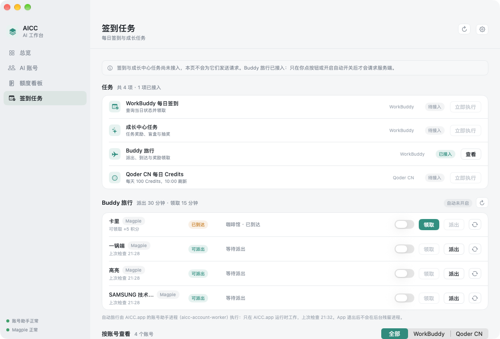

# Buddy 旅行（派猫猫旅行）——PR1c

AICC 自己管理 WorkBuddy 的「派 Buddy 旅行」：**检查资格 → 派出 → 等到达 → 领奖励 → 次日继续**。
和签到是两套独立任务，但在同一个控制台里管。

- 分支：`feature/workbuddy-travel-pr1c`（叠在 PR #63 `feature/workbuddy-login-pr1b1` 上）
- 助手方法：`travel.summary` / `travel.refresh` / `travel.depart` / `travel.claim` /
  `travel.setEnabled` / `travel.events` / `travel.auto.status` / `travel.auto.tick`
- 上游复用：`wb-switch-core` 的 `modules/travel.rs`（只复用无状态那一层，见 `vendor/VENDOR.md` 补丁 2）

## 1. 阶段 A：只读验证（4 个真实账号）

用 Magpie 里的 access token 只读请求 `/activity/growth/buddy/travel/{config,status}`，
**没有派出、没有领取**。结果（2026-11-10 21:20 GMT+8）：

| Magpie key | 令牌剩余 | `/config` | `/status` |
| --- | --- | --- | --- |
| `workbuddy` | ≈288 h | 200，4 个地点 | `arrived`，`record_id=43062741`，咖啡馆，6 天前出发未领取，`reward_credit=5`，`daily_limit_reached=false` |
| `workbuddy#uuf5pv` | ≈336 h | 200，4 个地点 | `idle`，`buddy_id=0`，无 record |
| `workbuddy#tg7q1s` | ≈336 h | 200，4 个地点 | 同上 |
| `workbuddy#2ntprc` | ≈384 h | 200，4 个地点 | 同上 |

地点列表（四个账号完全一致）：`1 咖啡馆 / 2 商场店铺 / 3 健身房 / 4 古镇客栈`。

### 实际字段与上游假设的差异

| 项 | 实际 | 处理 |
| --- | --- | --- |
| `/config` 的 `enabled` | **不存在**这个字段 | 上游按「缺省为 true」处理，正确；AICC 沿用 |
| `/config` 的地点字段 | `id` / `code` / `name` / `duration_hours` / `cover_url` | 上游只保留 `id` + `name`，够用；ETA 用 `/status.arrive_at`，不靠 `duration_hours` |
| `/status.server_now` | 有，秒级 | 只记录，不用于校时（本机时钟误差可忽略） |
| `daily_limit_reached` | `idle` 时才有意义（true = 官网「累了，明天再来吧」） | 状态机沿用上游判定 |
| 未领取的行程 | 6 天后仍是 `arrived`，服务端不会自己清 | 首次刷新即可见「已到达」，可手动领取 |
| 失败响应里的 HTTP 码 | 上游封装丢掉了 `code`，只剩一句 `error` | 打了补丁保留 `code`（`-3` = 结构不认识），否则 401 与 429 只能靠字符串猜 |

结论：接口契约与上游 `travel.rs` 一致，可以直接复用它的请求封装与状态机；
需要 AICC 自己补的是**调度、幂等、持久化与界面**。

## 2. 状态机

服务端 `state` 是唯一事实来源：

```text
idle ──(depart)──▶ traveling ──(到点)──▶ arrived ──(claim)──▶ idle
  ▲                                        │
  └────────── idle + daily_limit_reached ───┘   （今日已完，明天再来）
```

界面标签（落库字段 `travel_states.label`）：

| label | 含义 | 界面 |
| --- | --- | --- |
| `dispatchable` | 可派出（还没到 30 分钟派出窗口时只标这个，不派） | 可派出 |
| `traveling` | 旅行中 | 旅行中 + 预计到达 |
| `arrived` | 已到达未领取 | 已到达 |
| `done_today` | 今日已完成（服务端上限 / 本地当天已派 / 已领取） | 今日已完成 |
| `no_buddy` | 账号还没有 Buddy（可重试） | 无 Buddy |
| `unsupported` | 档位没有成长中心（国际版） | 不支持 |
| `failed` | 失败（带 `lastError` 与退避时间） | 失败 |
| `unknown` | 还没查过 | 待检查 |

判定顺序与本地护栏（`src/travel/state.rs::next_action`）：

1. `arrived` 且这一程没领过 → 领取；领过同一 `record_id` → 不重复提交。
2. `traveling` → 等。
3. `idle` + `daily_limit_reached` → 今日结束。
4. `idle` + 本地 `depart_date == 今天` → 今日结束（防止服务端上限字段异常时刷接口）。
5. `idle` → 派出。

## 3. 调度：谁在跑，跑多久

**承载进程：`aicc-account-worker`（AICC.app 的子进程）。AICC.app 退出 → 自动旅行停止。**
界面底部与 `travel.auto.status` 都会如实写这句话，不会暗示"后台还在跑"。

| 节奏 | 值 | 说明 |
| --- | --- | --- |
| tick 心跳 | 60 s | 到点才执行，空转很便宜；没开任何账号时立刻返回 |
| 状态查询 / 领取 | 15 min | 每账号 15 分钟查一次服务端状态，`arrived` 就领 |
| 派出窗口 | 30 min | 距上次**尝试**派出满 30 分钟才允许再派一次 |
| 失败退避 | 5 min → 1 h | `backoff = min(5min × 2^(n-1), 1h)` |
| 令牌失效冷却 | 6 h | 重试不会变好，等用户去 Magpie 重新登录或扫码 |

App 侧（`TravelAutomationService`）：上次退出前有账号开着自动旅行，启动时就把助手拉起来，
并每 120 秒看护一次（只重启死了的助手，不重复起进程）。

## 4. 幂等与并发

| 场景 | 处理 |
| --- | --- |
| 同一程重复领取 | `claimed_record_id` 记录已领的 `record_id`，相同则不提交 |
| 同一天重复派出 | `depart_date`（北京日期）+ 服务端 `daily_limit_reached` 双保险 |
| 别的客户端先派出 | 派出返回 `already traveling` → 标 `traveling` + 冲突提示，不报错 |
| 别的客户端先领走 | 领取返回 `no unclaimed travel` → 记「已在别处领取」+ 冲突提示 |
| 别的客户端结束了行程 | 本地 `traveling` 但服务端 `idle + daily_limit` → 冲突提示 |
| 自动与手动撞车 | 全局互斥（`E_TRAVEL_BUSY`），同一时刻只允许一个旅行操作 |
| 同账号多个请求 | 单线程 runtime + tick 跑在独立任务里，RPC 与 tick 不会互相覆盖快照 |

## 5. 安全边界

- **只用 access token。** payload 只有 `access_token` / `uid` / `domain` / `variant`；
  上游 `travel_request` 只在出现非空 `refresh_token` 时才刷新，AICC 不构造该字段，
  单测 `payload_never_carries_refresh_token` 盯着这一点。
- 401 时**只**重新从 Magpie 读一份 access（`resync_magpie_access`），一次机会，失败即 6 小时冷却。
  独立扫码授权的账号不走这条路，直接提示重新扫码。
- 只读 Magpie 的 `plugin-auth.json`，不写它的账号、签到记录或旅行配置。
- 令牌不进日志、SQLite、RPC 响应：`travel.summary` / `travel.refresh` 只回快照与事件文案，
  文案过 `sanitize`；单测 `travel_summary_is_local_and_token_free` 断言 1620 字节的假令牌不出现在响应里。
- 每次动作**先查服务端状态**再提交，避免与 Magpie / 官方网页重复操作。
- 401 / 429 / 超时都有明确收敛：不无限重试，429 与超时走退避。

## 6. 数据

迁移 v4（增量，已发布的库不重建）：

| 表 / 列 | 内容 |
| --- | --- |
| `accounts.travel_enabled` | 每账号独立开关，默认 0（关闭），与签到开关互不影响 |
| `travel_states` | 每账号一行最新快照：label、server_state、地点、`arrive_at`、`record_id`、`claimed`、`reward_credits`、`claimed_at`、`depart_date`、`failures`、`retry_after`、`conflict` |
| `travel_events` | 追加日志：`depart` / `claim` / `status` × `success` / `skipped` / `failed`，带积分与时间 |

跨日只把昨天的「今日已完成」降级成 `unknown`，**不清**历史积分与领取时间 ——
界面要显示「上次领取 +5」，而每日上限靠日期与 `daily_limit_reached` 判断。

## 7. 界面



（4 个真实账号，只做过只读查询：卡里已到达可领取，其余三个可派出。）

「签到任务」页新增 **Buddy 旅行** 区域（`ConsoleTravelSection.swift`）：

- 每账号一行：昵称（借用的标 `Magpie`）、状态徽章、目的地 + 预计到达时间、上次领取结果。
- 右侧：自动开关（默认关闭）、`领取` / `派出` / 刷新状态三个动作。
- 冲突与失败原因显示在该行下方（橙色），不弹窗。
- 底部固定一句：`自动旅行由 <进程> 执行：只在 AICC.app 运行时工作，上次检查 HH:mm。App 退出后不会在后台残留进程。`
- 快照 10 秒轮询一次（本地读取，不打接口）；只有点按钮才真的请求服务端。

## 8. 测试

```bash
# 状态机 / 幂等 / 令牌 / 退避（Mock，无网络）
cargo test --manifest-path account-worker/Cargo.toml

# 协议层（真进程 + JSONL）：summary 结构、开关落库、无账号时 tick 直接 idle
cargo test --manifest-path account-worker/Cargo.toml --test rpc_stdio

# 助手冒烟 + Swift 模型测试
bash scripts/smoke-test-account-worker.sh
swift test --package-path macos/MenuBarApp     # 需要 Xcode，CI 上跑
```

Mock 覆盖：状态机四分支、401 单次重同步、令牌失效 6 小时冷却、重复领取不提交、
每日上限、429 退避、超时、无 Buddy 可重试、地点不可用换下一个、冲突识别、调度到期判定。

## 9. 未做 / 已知限制

- 真实派出与领取**没有**执行（阶段 C 要求人工确认后才可以）。首次上线建议先点一次
  「刷新状态」看是否与官网一致，再点「派出」。
- 领取积分只记录服务端返回的 `reward_credit`，不做累计统计（Credits 统计在 PR3）。
- 助手是 App 的子进程：App 退出即停。要做到"关掉 App 也继续跑"需要 launchd 常驻，
  属 PR4 范围，本 PR 明确不做、也不假装做了。
