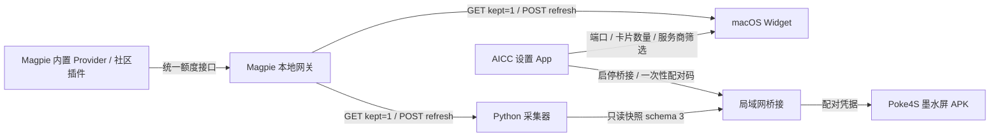

# Magpie 多服务商额度伴侣：架构、契约与验收边界

调查与实现日期：2026-10-20。本机 Magpie **0.1.1296**，默认 `127.0.0.1:3425`。
正式 AICC **2.10.2 / Build 15**；本轮只在 feature 分支与 PR #56 上开发，不合并、不发布、不覆盖正式安装包。

旧版文档（2026-10-14，Magpie 0.1.1230）只描述了 Codex 专项刷新，已被本轮取代。

## 一、结论先行

1. Magpie 是唯一的服务商认证、账号管理与额度采集来源。AICC 只读它的本机额度接口。
2. AICC 不再有 Codex / WorkBuddy / DeepSeek 独立采集器，也不读任何供应商凭据文件。
3. 新增服务商只要 Magpie 能返回额度行，Widget 与墨水屏就能显示，不需要改 AICC 采集器。
4. 三端（Python 桥接、Swift Widget、Android APK）共用一套 `schema_version: 3` 契约与同一套解释规则。

## 二、已核实的接口（Magpie 0.1.1296）

源码依据：[`internal/gateway/gateway.go`](https://github.com/yetone/magpie/blob/main/internal/gateway/gateway.go)、
[`internal/provider/quotas.go`](https://github.com/yetone/magpie/blob/main/internal/provider/quotas.go)、
[`docs/reference.md`](https://github.com/yetone/magpie/blob/main/docs/reference.md)。

| 接口 | 行为（实测） |
| --- | --- |
| `GET /v1/magpie/quotas?kept=1` | 返回 Magpie 上次读取的结果，不请求供应商、不等待读取。200，`{object:"list", data:[...]}` |
| `GET /v1/magpie/quotas` | 现场读取所有供应商，网关侧 12 秒超时 |
| `POST /v1/magpie/quotas/refresh` | 重读**所有**卡片并直接返回完整列表；同一卡片 30 秒内最多重读一次 |
| `POST /v1/magpie/quotas/refresh?provider=<id>` | 只重读该 provider，仍返回完整列表；未知 provider 是空操作（200 + 原列表） |
| `GET /v1/magpie/quotas/history` | 额度历史，AICC 不使用 |

鉴权：本机（loopback）直接可读；跨机需要共享网关 Key。AICC 只走 loopback，从不持有网关 Key。

`Quota` 字段：`provider`、`name`、`kind`（`subscription`/`plan`/`balance`）、`plan`、`user`、`windows`、`balance`、
`balanceSplit`、`error`、`asOf`、`readDeferred`、`readAt`、`until`、`renew`、`resets`、`resetsUsed`、`lastServedAt`、
`last`、`from`、`alias`、`seat`。
`QuotaSpan` 字段：`name`、`used`、`remaining`、`resetsAt`、`display`、`amount`、`limit`、`unit`、`pool`、`unlimited`、`holds`。

**本机实测的两个反例**（说明为什么不能写死窗口）：

- Antigravity 的窗口名随上游变化：未刷新时是 `Gemini · 7 days`，刷新后变成 `Gemini 3.8 Flash (High)` 等 7 个窗口，且出现两个同名 `7 days`。
- WorkBuddy 的窗口叫 `Credits`，`used=0.048`、`remaining=99.95`，真实用量在 `display="2.27 / 4723"` 里。

## 三、数据流

- Widget 直接读 Magpie，不依赖 AICC 常驻，也不依赖 Python 服务。
- 桥接只做「同一份快照的只读转发」，不做第二套采集。
- APK 只认桥接凭据，不持有 Magpie 网关 Key。

## 四、通用数据模型（`schema_version: 3`）

字段级契约见 `collectors/magpie.py`、`macos/MenuBarApp/Sources/Models/QuotaModel.swift`、
`android/.../DashboardData.java`，三者规则必须一致：

| 规则 | 说明 |
| --- | --- |
| 账号标识 | 快照只写 `id = "magpie-" + sha256(from, provider, kind, user)[:12]` 和 `account_label`（首字符 + `***`；Magpie 的 `alias`/`seat` 若不含 `@` 且不超过 24 字符则原样显示）。邮箱、原始账号名、错误文本、凭据一律不落盘 |
| 窗口 | 保留原始 `name`，不做 `five_hour`/`weekly` 映射；同名窗口各算一条（真实数据会出现） |
| 展示值 | `unlimited` → ∞；否则 `display` 优先；否则剩余百分比；都没有 → 未知（`—`） |
| 百分比 | 仅当数值有限且落在 0…100 时采用；布尔、字符串、NaN、越界都是未知，不是 0 |
| 重置时间 | 只用 `resetsAt`；缺失即「未知」，绝不推算 |
| 余额 | `balance`/`balanceSplit` 原样展示金额，不换算百分比，不因没有窗口而隐藏 |
| 新鲜度 | `error`、`readDeferred`、`asOf`（缓存读）、缺 `readAt`、`readAt` 超过 300 秒或来自未来 60 秒以上 → 该卡 `stale`；账号级独立判断 |
| 未知 Provider | 保留；显示名用映射表，未命中则把 id 转成 Title Case |
| 未知 `kind` | 丢弃该行（无法解释语义），其他行不受影响 |
| 坏行 | 单行不可读只丢该行；只有信封（`object`/`data`）非法才整份报错 |
| 重复账号 | 同 `(from, provider, kind, user)` 视为同一卡，保留 `readAt` 较新的一条 |

快照顶层：`schema_version`、`source`、`available`、`state`（`Connected`/`Cached`/`Empty`）、`stale`、`providers`、
`accounts`、`updated_at`、`updated_epoch`、`refresh_seconds`。

## 五、刷新与缓存策略

- 刷新周期只有一处：`collectors/magpie.py` 的 `REFRESH_SECONDS = 300`；Swift 侧 `QuotaPolicy.refreshSeconds` 与其对齐，
  桥接把同一数值下发给 APK（`refresh_seconds`）。
- 普通读取一律用 `?kept=1`，不让每次 Widget 时间线刷新或 APK 轮询都去打上游。
- 手动刷新（Widget 点击 / App 内刷新链接）走 `POST /v1/magpie/quotas/refresh`，即刷新**所有** provider，不再写死 Codex。
- 强制刷新直接用 refresh 的响应作为本次快照，一次请求完成「刷新 + 读取」；失败则退回 `kept=1`。
- Magpie 自己的 30 秒/卡限制不被绕过；Widget 端另有 300 秒的最小间隔、60 秒兜底，避免时间线抖动造成连续刷新。
- 缓存写入：同目录临时文件 → `fsync` → `os.replace`，权限 0600，断电不会留下半份 JSON。
- 旧 `schema_version: 2` 缓存不再解释（不猜字段），直接视为无缓存。

## 六、桥接与安全边界

- `/api/status` 默认返回 `schema_version: 3`；`?format=2` 或 `X-AICC-Schema: 2` 返回旧 `codex` 结构，
  由同一份通用快照派生（明确的版本分支，不是字段级猜测）。
- 网络设备只能 `GET /api/status`；`POST /api/refresh`、`/api/pairing`、`/api/shutdown`、任何 Magpie 刷新/账号接口一律 403。
- 配对码一次性、120 秒有效、最多 5 次尝试；读取限速 60 次/分钟；响应 `no-store` + `nosniff`；1 MiB 上限。
- 凭据：Mac Keychain → stdin → Python 内存；Android Keystore 加密并绑定 `host_id`；撤销全部设备即换凭据。
- 桥接仍是**明文 HTTP 局域网**：只适合可信网络，不适合公网。凭据只授权匿名额度读取，不能调用模型。
- Widget 侧：仅 loopback、禁用代理、禁止重定向、端口隔离缓存、1 MiB 上限。

## 七、三端落地

### Python（`collectors/magpie.py`、`server.py`）

通用采集 + 规范化 + 原子缓存 + 统一刷新；桥接输出通用列表与 `format=2` 兼容层。
测试：`tests/test_magpie.py`、`tests/test_bridge.py`。

### macOS Widget（`macos/Widget/`、`macos/MenuBarApp/Sources/Models/QuotaModel.swift`）

- 模型：`QuotaSnapshot`/`QuotaCard`/`QuotaItem`，与 Python 同规则。
- 视图：Small 最多 2 张卡、Medium 最多 4 张；每张卡一个服务商账号，展示前两个窗口，溢出显示 `+N`；
  无数据/离线/缓存/失败都有明确状态。
- 配置：端口、显示数量（自动/1/2/4/全部）、服务商筛选，写在 Widget 自己的 display-settings 域；
  旧 `accounts` 键仍可解码。注册身份 `com.aieink.dashboard.menubar.widget` 与 `StaticConfiguration` 未变。
- 刷新：点击 Widget 走 `aicc-widget://refresh`，由宿主执行一次全 provider 刷新并重载时间线。
- **限制**：WidgetKit 不保证时间线准点，`refresh_seconds` 只是「请求重载」的节奏，不是实时定时器。

### Android / Poke4S（`android/poke-dashboard`）

- `DashboardData`：解析 schema 3；显式分支读取旧 `codex` 结构；每页 4 张卡；1/2/全部三种数量；全部模式可翻页。
- `DashboardView`：电子墨水排版，长名称按宽度缩放，余额与百分比分开表达，状态（缓存/失败/跳过）右上角标注。
- 仅在 `renderKey` 变化时重绘；保留闪刷校准、休眠暂停、唤醒更新与缓存。
- 请求带 `X-AICC-Schema: 3`，与桥接显式协商版本；包身份、签名、权限、Keystore、禁止备份策略未改。

## 八、接口不可用时

升级 Magpie 后接口改变、loopback 受保护或服务商全部未登录时：显示缓存或「无额度」，
不回退到读账号 auth 文件、不编造另一个接口、不把缺失当 0。诊断只需 Magpie 版本、监听端口、
`providers` 列表与脱敏状态。

## 九、验收情况

见 [`docs/ACCEPTANCE.md`](ACCEPTANCE.md)；服务商逐项结论见 [`docs/PROVIDER-COMPATIBILITY.md`](PROVIDER-COMPATIBILITY.md)。
