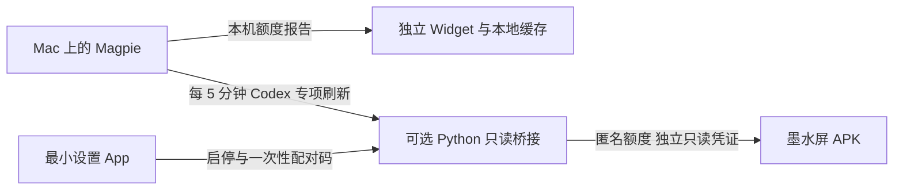

# Magpie 显示伴侣：接口证据与验收边界

调查日期：2026-10-14。本机 Magpie **0.1.1230**，默认 `127.0.0.1:3425`。
正式 AICC **2.10.2 / Build 15**；本轮仅修改 feature 分支及 PR，不合并、不安装、不发布。

## 已确认的数据与插件能力

Magpie 官方项目为 [yetone/magpie](https://github.com/yetone/magpie)。最初接口调查固定在
[`06c3370`](https://github.com/yetone/magpie/tree/06c3370b749763f3ff73f29dd50ff45abdad7ee0)，
后续插件能力审核读取了 [`c8c3ce9`](https://github.com/yetone/magpie/tree/c8c3ce9a9a58b53db6bc7cab724dd7590af41221)。
Magpie 的代理和模型协议兼容性不等于 OpenCodex Account Pool 的 CLI/账号/额度字段兼容。

| 实际接口 | 已确认用途 |
| --- | --- |
| `GET /v1/magpie/quotas?kept=1` | 标准已保存额度报告，`object=list,data`；不读取上游 |
| `POST /v1/magpie/quotas/refresh?provider=codex` | Codex 专项刷新，之后再 GET 标准报告；Magpie 有 30 秒保护 |
| `GET /v1/magpie/quotas/cards` | 原始额度卡片；本实现不依赖它 |

前两项已在本机验证，存在官方说明和源码实现；**未查到跨版本不变的稳定性承诺**。
依据：[集成说明](https://github.com/yetone/magpie/blob/06c3370b749763f3ff73f29dd50ff45abdad7ee0/docs/integrating.md)、
[gateway.go](https://github.com/yetone/magpie/blob/06c3370b749763f3ff73f29dd50ff45abdad7ee0/internal/gateway/gateway.go)、
[quotas.go](https://github.com/yetone/magpie/blob/06c3370b749763f3ff73f29dd50ff45abdad7ee0/internal/provider/quotas.go)。

Codex `subscription` 行按账号读取 `5 hours` 和 `7 days`，`used` 转为剩余百分比；
原始 `user` 不落盘，转换为来源与账号身份的匿名散列。`last` 是最近服务过请求，不代表当前固定
账号，不生成 Active/pinned。缺失、错误、过期、布尔或无效百分比均不能伪装成真实零值。
这是订阅窗口额度，不能从模型 token 消耗或 API Key 金额余额推算。

官方插件覆盖供应商认证/模型、网关中间件和 Agent 配置；旧 integrating.md 的插件分类与新文档
存在差异，应以相应版本源码核对。当前官方源码和社区目录中未发现 macOS WidgetKit 或墨水屏
APK 插件；Linux Omarchy 的状态栏组件不等于上述平台能力。
依据：[插件文档](https://usemagpie.ai/docs/plugins)、[社区插件目录](https://github.com/magpie-community/plugins)。
因此本实现是独立显示伴侣，不冒充已注册的 Magpie 插件。

网络额度读取依赖 Magpie 共享网关鉴权；预算/模型/账号受限的共享 Key 会被拒绝读取额度，
未发现专用只读额度 Token。APK 不直连 Magpie，也不持有能调用模型的完整共享 Key。

## 最终结构

- Widget 自己配置端口和账号数量，不依赖宿主偏好同步或 `/api/display-snapshot`。
  读取受限于 literal loopback，关闭代理与重定向；缓存按端口隔离。旧配置仍可解码，
  停用指标明确显示未知。WidgetKit 决定实际时间线频率。
- 设置 App 保留原 bundle/Widget/App Intent 身份。没有 NSStatusItem、弹出看板或供应商控制。
  桥接默认关闭；关闭窗口是否退出取决于桥接开关。登录启动启用桥接时留在后台，否则退出。
- Python 只包含 Magpie 适配器与桥接。刷新独立于设备读取，每 300 秒一次；GET 不触发供应商请求。
  故障保持 Magpie 来源缓存，每个账号独立判断源年龄。没有 WorkBuddy 自动重启或 Codex app-server。
- APK 用独立桥接凭据读取，不允许网络刷新、写入显示快照、供应商控制或关闭服务。
  配对码一次性、120 秒有效、全局最多 5 次尝试，另有请求限速和体积上限。
  管理/配对码生成要求 loopback、正常本机 Host 和没有跨站 Origin。
- 凭据通过 Mac Keychain → stdin → Python 内存；Android Keystore 加密持久化并绑定已配对主机。
  未授权状态返回 401；撤销全部设备会更换凭据。代码、URL、日志、截图与普通文件不保存真实明文密钥。
- 当前 HTTP LAN 未加密，配对凭据可能被同网段监听者获取；凭据只授权匿名额度读取，不能调用
  Magpie 模型。可信局域网为使用边界，公网/TLS/远程 Magpie 不属于本轮范围。

## 接口不可用时

升级 Magpie 后接口改变、loopback 配置受保护或无 Codex subscription 时，显示缓存/未知，
不切回 OpenCodex、不读账号 auth 文件、不编造另一个接口。不请求用户提交任何密码或 Key。
最少诊断信息为 Magpie 版本、本机监听端口、是否包含 Codex 订阅账号和脱敏错误状态；
随后针对官方源码确认适配。如果官方只剩模型 API，则不能提供准确订阅额度。

## 验收

测试覆盖只读鉴权、配对超时/单次/尝试限制、撤销、跨主机凭据隔离、匿名化、逐账号源过期、
断线恢复、未知值、Widget 无宿主依赖、旧配置解码、端口隔离、App Intents 双 bundle 注册，
以及原生设置、Widget 和 Android 画面。退役采集器的测试随实现删除，使用对应新边界测试替代。
具体最终测试数字及 CI 记录见 PR 验收报告。

未确认：真实 Magpie 多账号、桌面安装后的 WidgetKit 调度、登录启动/关闭窗口完整安装态行为、
Poke4S 配对与 IP 迁移真机、残影与功耗、Magpie 后续版本兼容性。模型单元测试或模拟器截图不代表真机结果。
只有完成这些额外验收才需要确认“是否有多个本机 Codex 账号”和“是否有可连接的 Poke4S”，无需凭据。

CI 截图 artifacts：`magpie-settings-visuals`、`magpie-widget-visuals`、`magpie-android-visuals`。
CI App/DMG/APK 均为候选，现有正式版、更新清单与本机 dist 不变。
