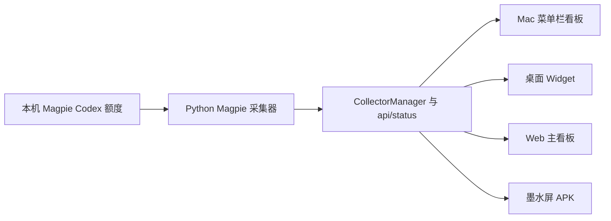

# AICC：Magpie 数据源迁移与 Codex 优先界面

调查日期：2026-10-14。当前 main：`333d69ba72f27ae4963fd6a643802f862719886a`。
GitHub 最新正式版已核实为 **v2.10.2 / macOS Build 15**，不是背景材料中的 v2.10.0。
本轮只提交 feature 分支和 PR；不合并 main、不改 VERSION、更新清单或发布正式版本。

## 已核实的 Magpie 能力

官方项目：[yetone/magpie](https://github.com/yetone/magpie)。源码调查固定在
[`06c3370b749763f3ff73f29dd50ff45abdad7ee0`](https://github.com/yetone/magpie/tree/06c3370b749763f3ff73f29dd50ff45abdad7ee0)。
本机安装 `/Applications/magpie.app`，版本 **0.1.1230**；CLI 没有加入本机 PATH。

Magpie 是代理配置管理和模型网关：默认监听 `127.0.0.1:3425/v1`，处理 Responses、Chat Completions、
Anthropic Messages 等协议并转发模型请求。它发现代理自身的登录、管理额外订阅账号和路由规则，
还支持 API Key 套餐和余额。这不意味着它与 OpenCodex Account Pool 的 CLI、字段或账号选择语义兼容。
依据：[官方手册](https://github.com/yetone/magpie/blob/06c3370b749763f3ff73f29dd50ff45abdad7ee0/docs/reference.md)。

**存在官方说明、源码实现且本机已验证可读取的额度接口；没有查到跨版本不变的稳定性承诺。**
应把它作为有版本约束的适配接口维护，不能承诺任何未来 Magpie 版本都兼容。

| 接口 | 作用 | 本机验证 |
| --- | --- | --- |
| `GET /v1/magpie/quotas?kept=1` | 已保存的标准额度报告；不请求上游 | PASS，含 Codex subscription 的 windows、used、remaining、readAt |
| `GET /v1/magpie/quotas/cards` | Magpie 已保存的原始卡片 | PASS，窗口提供 used，不保证有 remaining |
| `POST /v1/magpie/quotas/refresh?provider=codex` | 只更新本机 Codex 订阅账号，随后读取已保存报告 | PASS，刷新后 1 个本机账号返回真实 5h 和周额度 |
| `magpie quota codex --json` | CLI 的标准额度报告 | 官方源码确认；本轮没有执行本机 CLI |

路由及 JSON 包装依据：
[gateway.go](https://github.com/yetone/magpie/blob/06c3370b749763f3ff73f29dd50ff45abdad7ee0/internal/gateway/gateway.go)、
[quotas.go](https://github.com/yetone/magpie/blob/06c3370b749763f3ff73f29dd50ff45abdad7ee0/internal/provider/quotas.go)、
[quota_cli.go](https://github.com/yetone/magpie/blob/06c3370b749763f3ff73f29dd50ff45abdad7ee0/internal/cli/quota_cli.go)。

Codex 额度源于 Magpie 使用登录会话读取 ChatGPT 的 `/wham/usage`，并按上游窗口时长生成
`5 hours` 和 `7 days`。这是订阅窗口百分比，不能等同网关记录的 token 消耗或 API Key 的金额余额。
依据：[subscription_usage.go](https://github.com/yetone/magpie/blob/06c3370b749763f3ff73f29dd50ff45abdad7ee0/internal/provider/subscription_usage.go)。

本机 loopback 请求已验证无须 AICC 读取密钥；网络共享需要 Magpie 的网关鉴权，而且受限制的共享 Key
可能无法读取额度。当前 AICC 适配器只接本机地址，不启用共享、不读取或转发网关密钥。

Magpie 的配置与额度缓存通常在 `~/.config/magpie`，也有 XDG 和 portable 路径。
`providers.json`、账号存储及代理 auth 文件可能包含凭据；本轮没有读取这些本机文件。
额度缓存 `quotas.json`、历史 `quota-history.json` 的结构受版本影响，**不作为默认采集入口**。
依据：[appdir](https://github.com/yetone/magpie/blob/06c3370b749763f3ff73f29dd50ff45abdad7ee0/internal/appdir/appdir.go)、
[quota_last.go](https://github.com/yetone/magpie/blob/06c3370b749763f3ff73f29dd50ff45abdad7ee0/internal/provider/quota_last.go)。

## 架构与本轮落地

现有 Python 标准库后端通过 CollectorManager 并发采集并缓存 `/api/status`。
macOS 原生菜单栏看板与 Widget 使用同一 WidgetDisplaySnapshot 和账号 resolver；
Web 看板和 Android Canvas 客户端也读取 `/api/status`。Android 使用 UDP 发现、状态探测和 IP 迁移。
本轮继续使用这些结构，不增加第二个后端或第三方运行依赖。

- `AICC_CODEX_SOURCE=auto` 优先选择已安装的 Magpie；没有发现 Magpie 时使用原有 Codex app-server。
  停用自动发现 OpenCodex；旧用户可显式选择 `opencodex`。也可指定 `magpie` 或 `app-server`。
- `AICC_MAGPIE_URL` 默认 `http://127.0.0.1:3425`，只允许带端口的 loopback HTTP 地址。
  禁止 URL 凭据、非本机地址、代理和 HTTP 重定向。
- 每 120 秒发起 Codex 专项额度更新，再读 `?kept=1` 报告；手动刷新走相同的专项入口。
  Magpie 自身对专项刷新有 30 秒间隔保护，因此短时间连续点击不保证生成新上游读数。
  原有 CollectorManager 合并并发和手动刷新，超时预算为 55 秒。
- 只接受本机 `provider=codex`、`kind=subscription`；逐账号映射 windows，不合计、平均或推算总额度。
  `used` 转换为剩余百分比，缺失、布尔值和非有限值保留未知。
- 邮箱转为稳定匿名账号 ID；报告、日志、缓存和截图不保存原始邮箱、令牌或上游错误正文。
  `last` 表示最近服务过请求，不是当前固定账号，因此不生成 Active/pinned。
- 使用独立 `magpie_last_success.json`。故障和超时保留 Magpie 缓存，不切回另一账号来源。
  超过 5 分钟的源读数、已过重置时间、缺少读取时间或上游返回错误，都标记缓存。
  不能用本次 HTTP 收包时间冒充上游读数时间。
  单个账号读数过期只标记该账号；整体请求失败或所有账号过期时，整体标记缓存。
- Magpie 模式不再调用 OpenCodex Google 额度入口。WorkBuddy 自动重启修复在该模式默认关闭；
  保留已有的显式 `WORKBUDDY_AUTO_HEAL=1` 开关和手动重连能力。

## UI 与刷新策略

| 页面 | 本轮行为 | 可执行的后续验收 |
| --- | --- | --- |
| Mac 菜单栏看板 | Codex/来源在首位，保留 1/2/全部账号偏好；其他服务默认折叠，系统及 OpenCodex 控制默认不展示 | 真正安装候选 App 后检查菜单栏弹窗、不同账号数量、浅深色和异常状态 |
| Mac 菜单栏图标 | 继续使用共享 snapshot 的 Codex 数值；不把 last-served 账号称为 Active | 用真实多账号核对排序、切换显示偏好后 Widget 同步 |
| Widget | Magpie + 默认配置显示 Codex 专用版面；单账号并列周/5h，多账号小尺寸最多 2、中尺寸最多 4，溢出显示 +N；已有自定义槽位保留 | 安装后核对 App Intents 注册、桌面时间线和系统刷新预算 |
| Web 主看板 | 按账号展示周/5h，其他服务折叠，缺失重置机会隐藏，离线显示缓存 | 浏览器确认移动和桌面宽度、缓存提示和键盘访问 |
| Android APK | Codex 占主页面，单账号及多账号独立两窗口，未知为 —，不占用重置机会/系统/余额大卡片 | 模拟器原生 Canvas 测试覆盖单/双/7 账号、分页、空池、缓存、未知 |
| 墨水屏刷新 | 默认 5 分钟；可调 1–60 分钟；回前台立即取数，休眠停止轮询，联网恢复清除离线提示；无关状态变化不重绘，12 次有效重绘后全黑闪一次 | Poke4S 真机检查残影、睡眠/唤醒、电量、连续 24 小时耗电 |

默认显示偏好仍为 automatic（最多 2 个）；Android 的 all 模式每页 4 个，可点击翻页。
Widget 的 +N 表示当前显示偏好范围内的溢出，不代表账号被删除。
刷新按钮仍只在 Mac 本机允许触发后端操作，局域网 Android/Web 保持读取权限。

## 无法连接时的现实适配路径

1. 已安装版本接口可用：使用本轮本地 HTTP 适配器，已有单账号联调不需要用户提供密钥。
2. 若其他版本返回 404：显示不可用并保留缓存，先核对 Magpie 版本和网关端口。
   可核实该版本的 `magpie quota codex --json`，另做有超时和输出白名单的 CLI 适配；本轮不凭空实现兼容。
3. 若只有代理模型 API 或第三方 Key：不能由模型调用量推算 ChatGPT 订阅额度；保持未知。
   用户仍有独立 ChatGPT 登录时，可显式选择现有 app-server 作为单账号来源，并明确显示其来源。
4. 若需要远程 Magpie：另做 Keychain 保存、只读权限验证和 LAN 鉴权方案；本轮不暴露凭据到 Android。

## 验证记录与尚未确认项

- 本机 Magpie 0.1.1230 的缓存读取及 Codex 专项刷新联调：PASS，1 个真实账号，两窗口均有读数。
- Python 后端回归：127 项 PASS（在可绑定临时本机端口的环境运行）；新增配额、隐私、形状、来源、缓存和故障回归。
- Python lint 和 Web 数值/多账号/未知/缓存回归：PASS。
- 原生 Widget 已生成 504 张中英文、浅深色及边界状态渲染图；原有对称性检查保留，新增专用版面检查尺寸并人工看图。
- Mac 看板采用原生 NSHostingView 截图；不用 ImageRenderer 替代 AppKit 毛玻璃背景。
- 本机只有 Command Line Tools，SwiftPM XCTest 不可用；完整 Swift 测试与 App/Widget 打包以 PR CI 为准。
- 本机原有 dist 中存在 2.10.1 构建，版本检查发现与源码 2.10.2 不一致；保留该既有产物，候选包由 CI 重新构建和验证。
- 本机未配置 Android SDK；Android 单元测试、APK 构建和原生渲染验收通过 PR CI 执行。
- CI 保留原有 test/lint/android/swift-test/macos-build 五项检查，并增加 Android 模拟器图像验收。
  App/DMG/APK 均为 CI 候选构建，版本号保持不变，不作为正式升级包发布。

尚未确认：真实 Magpie 多账号、重新登录错误的稳定机器字段、非本机 Magpie、上游长期接口兼容、
桌面 Widget 安装后的时间线刷新，以及 Poke4S 的残影和功耗。没有将夹具或模拟器测试写成真机验证。

需要用户协助的最少信息：只有希望完成这些额外验收时，提供“是否使用多个本机 Codex 订阅账号”
和“Poke4S 是否可连接进行真机测试”即可；无需提供密码、邮箱清单、API Key、Token 或 auth 文件。

验收截图在 PR CI 的 `magpie-dashboard-visuals`、`magpie-widget-visuals`、`magpie-android-visuals` artifacts。
最终测试数字及 CI 状态见该 PR 的验收记录；此文档中的本机结果不代替 CI 状态。
